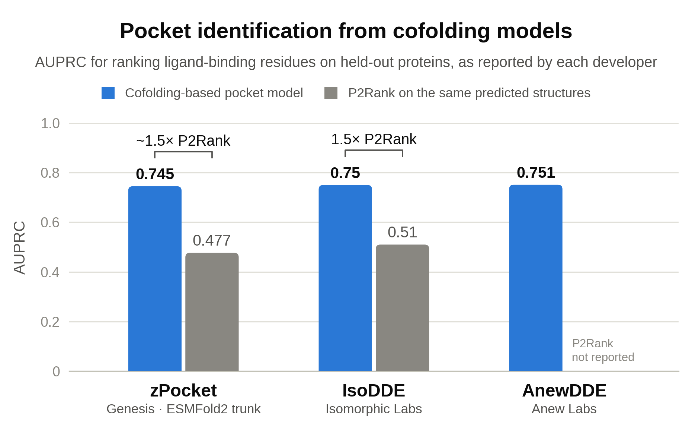

*Each bar is the number its developer reported on their own held-out test set, so this is
not a head-to-head benchmark. Sources and caveats are in
[`press_images/README.md`](press_images/README.md).*

# zPocket

**Ligand-binding pocket prediction on predicted structures.** zPocket folds a
single-chain protein with ESMFold2 and applies a 330k-parameter `pairformer2` head
to the frozen pair representation `z`, producing per-residue pocket probabilities.
These can be clustered into ranked pocket centres and evaluated on PocketWatch.

- Pre-print: [`arxiv`](https://arxiv.org/abs/2610.17696)
- Model weights: [`genesisml/zPocket`](https://huggingface.co/genesisml/zPocket)
- Dataset: [`genesisml/PocketWatch`](https://huggingface.co/datasets/genesisml/PocketWatch)

ESMFold2 is the only supported trunk. The paper also reports stronger results with
Protenix-v2, but that backend was removed because its weights are no longer publicly
available.

![Three-panel overview from the paper. A: a protein sequence and its MSA are folded by a frozen co-folding trunk, and a trained zPocket head turns the frozen features into a per-residue pocket probability. B: cereblon (UniProt Q96SW2), with the predicted probability painted on its ESMFold2 fold and plotted along the sequence; site S1 was already known before the training cutoff and S2 is novel and cryptic. C: per-pocket AUPRC against pocket similarity to the pre-cutoff record, where zPocket scores above P2Rank and the PocketWatch-retrained UniSite-1D and VN-EGNN in every bin.](press_images/paper_figure1.png)

*Figure 1 of the paper. **(A)** A frozen co-folding trunk folds the sequence, and a small
head trained on its frozen features predicts a pocket probability for every residue.
**(B)** Cereblon (UniProt Q96SW2). Site S1 was already in the pre-cutoff record, so its
residues are masked from scoring; S2 is novel and cryptic. **(C)** Per-pocket AUPRC on the
PocketWatch test set, binned by how much of each pocket a pre-cutoff pocket already covers.
zPocket (ESMFold2 trunk, `pairformer2` head) leads every baseline in every bin; UniSite-1D
and VN-EGNN are both retrained on PocketWatch.*

## Install

From the repository root:

```bash
pip install -e .
```

Requires Python 3.12; folding requires a CUDA GPU. Installation includes `esm>=3.4.1`,
which provides ESMFold2. `eval`, `centroids`, and `predict` run without a GPU or trunk
weights.

## Weights

Download the trunk, ESMC-6B backbone, and pocket head. Check their access and license
requirements before use.

```bash
huggingface-cli download biohub/ESMFold2 \
    --revision e1e189d0f5fb70c2693da2332eca4443c0ccccd6 --local-dir weights/esmfold2
huggingface-cli download biohub/ESMC-6B --local-dir weights/esmc-6b
huggingface-cli download genesisml/zPocket --local-dir weights/zpocket
```

Use the pinned ESMFold2 revision for reproduction: it matches the weight digest
recorded in the zPocket model card. Passing a repo ID instead of a local directory
applies this pin automatically. The pinned revision contains the decoder only and
uses a separate ESMC-6B backbone (~24 GB); `main` bundles the same trunk and backbone
and can load without `--esmc-dir`, but has a different recorded digest.

The model card's SHA256 labels for `model.safetensors` and `config.json` are
transposed; the weights themselves are correct.

`--esmc-dir` and `--ccd` are optional: without them, `esm` resolves the backbone and
CCD dictionary, potentially using the network. Supply both for offline use. The
CCD file must be named `ccd.pkl`; its parent directory is used as `ccd_cache`.
`--esmc-precision bf16` is the published default; try `fp32` if folding produces NaNs
or SVD non-convergence.

## Predict pockets

`run` folds and scores each FASTA record without saving the quadratic pair tensor.
Supply `my_msas/<record_id>.a3m`, or use `--no-msa` for weaker single-sequence predictions.

```bash
zpocket run \
    --fasta my_protein.fasta \
    --msa-dir my_msas/ \
    --head weights/zpocket/model.safetensors \
    --model-dir weights/esmfold2 \
    --esmc-dir weights/esmc-6b \
    --ccd weights/esmfold2/ccd.pkl \
    --out results/
```

For each record:

| File | Contents |
|---|---|
| `<id>_pocket_probs.tsv` | 1-based `resnum` and `prob` |
| `<id>_pocket_probs.npz` | `probs`, shape `(L,)` |
| `<id>_sample0.cif` | Predicted fold, residues numbered 1..L, pLDDT in the B-factor column |

Probabilities rank residues; they are not a universal yes/no cutoff. To obtain pocket
centres with the published weighted mean-shift decoder:

```python
import numpy as np
from zpocket.discrete import cluster, load_fold

probs = np.load("results/my_protein_pocket_probs.npz")["probs"]
fold = load_fold("results/my_protein_sample0.cif", "my_protein", len(probs))
for c in cluster(
    probs, fold, method="meanshift", score_threshold=0.3, bandwidth=14.0, min_residues=3
):
    print(c.rank, c.center, c.descriptors["n_residues"])
```

Centres are ranked best-first. These decoder settings are also the defaults for
`cluster` and `eval`; they were selected on validation and frozen before test.
`method="linkage"` uses a different decoder and does not reproduce the published
localization results.

The head was trained on single-chain monomer folds, so it cannot place pockets
formed only at chain interfaces. Predictions in low-pLDDT regions are unreliable;
check the fold's B-factors.

## Reproduce the PocketWatch benchmark

PocketWatch defines sites from Q-BioLiP/PDB contacts at 5 Å and splits them by first
release date, with a test cutoff of 2024-01-01. The test split contains 1,566 proteins
and 1,573 scored pockets, with a 4.86% positive-residue rate. Data loads from the Hub
on demand, or from a local tree supplied with `--dataset-root`.

### Site policy and scoring basis

Both residue and centroid evaluation use `data/site_policy.parquet` to select scored
sites. Across all splits, 14,928 sites are scored and 3,869 masked: 3,318 interface-only,
495 pre-cutoff, 49 without expressible residues, and 7 subsumed by already-public pockets.

**Excluded sites are masked, not negative.** Their residues are excluded from other
pockets' backgrounds, and predicted centres landing on them are removed from the
ranked list rather than counted as false positives.

| Scoring basis | Flags | Targets | Per-target AUPRC |
|---|---|---|---|
| Paper table | `--paper-set --multichain mask` | 1,275 (1,562 pockets) | 0.745 |
| Checkpoint's logged metric | `--multichain keep` | 1,559 | 0.734 |

`keep` treats interface-only contacts as positives, matching training and checkpoint
logging. `mask` removes them and proteins whose only new pockets are interface-only.
`--paper-set` additionally excludes `A0A655NVH2`, `P03441`, `Q7XJE8`, and `Q962Y6`, whose
non-standard residues cannot be read by the VN-EGNN baseline. Use this flag when
comparing with the paper table. The released ESMFold2 head is `pw1g0` (balanced BCE).

### Fold, score, and evaluate

```bash
# Download the pre-merged test MSAs and extract into work/.
mkdir -p work
huggingface-cli download genesisml/PocketWatch msas_test.tar \
    --repo-type dataset --local-dir dl/
tar -xf dl/msas_test.tar -C work/

# The archive contains one msas_test/<uniprot_id>.a3m.gz per protein.
# run uses the published folding defaults and does not persist z.
zpocket run --split-source --split test \
    --head weights/zpocket/model.safetensors \
    --model-dir weights/esmfold2 --esmc-dir weights/esmc-6b --ccd weights/esmfold2/ccd.pkl \
    --msa-dir work/msas_test/ \
    --out folds/ --scores-out scores.npz

# Evaluate with the release's ESMFold2 structures and matching shipped centroids.
# Replace <release> with the local PocketWatch release directory.
zpocket eval --scores scores.npz --split test --paper-set --multichain mask \
    --structures-dir <release>/structures \
    --out results.json
```

`eval` reports per-target AUPRC, AUROC, R-precision and hit@1; per-pocket AUPRC, including
single- versus multi-pocket proteins; and centroid DCC at top-N and top-N+2. Its JSON
includes one row per scored pocket. Add `--no-centroid` to evaluate score vectors
without structures.

For multiple GPUs, use `--shard i/n` (1-based) with a separate `--scores-out` and
`CUDA_VISIBLE_DEVICES` for each shard, then merge the NPZs by protein ID. Records are
distributed round-robin after sorting by length. The longest test proteins (L=1,198)
require more than 48 GB with ESMC-6B resident: about 75 fail on 48 GB cards; 96 GB fits
the full split. Sharding does not reduce per-protein peak memory.

### Reference results

ESMFold2 `pairformer2`, on the paper set (`--paper-set --multichain mask`):

| AUPRC_t | AUROC_t | Rp_t | AUPRC_p | AUROC_p | Rp_p | AUPRC_p: 1 pocket | AUPRC_p: >1 pocket |
|---|---|---|---|---|---|---|---|
| 0.745 | 0.951 | 0.682 | 0.702 | 0.941 | 0.639 | 0.751 | 0.599 |

For the published mean-shift decoder, DCC at 4 Å is **0.515 top-N / 0.524 top-N+2**
(ceiling 0.524, AP 0.570, precision 0.599, mean 1.1 pockets per protein).

Exact agreement is not expected: the initial pair state is sampled from a truncated
normal, and LM dropout (`p=0.25`, fresh mask per loop) is active at inference. Seeds
and hardware affect the features. Published head predictions used CUDA/bfloat16
autocast with fp32 LayerNorms and readout; `run` and `predict` compute the head in
fp32, with probability differences up to 0.010 reported in the model card. Without
`transformer_engine`, `xformers`, and `flash-attn`, ESMC falls back to PyTorch kernels,
which `esm` reports can differ by a few ULP after the final LayerNorm.

zPocket also enables published-checkpoint compatibility by default. The historical
training stack discarded MSA deletion features, consumed the complete unmasked MSA,
and used full atom attention. Current `esm` does none of those by default, so zPocket
reproduces the historical semantics explicitly. Use `--modern-esm-semantics` only
when you intentionally want current `esm` behavior rather than features compatible
with the released pocket head.

### Centroids for your own folds

Ground-truth centroids and structures must share a coordinate frame. The release's
centroids match its shipped ESMFold2 folds. For folds you generated, rebuild the
centroids before evaluating localization:

```bash
zpocket centroids --structures-dir folds/ --out site_centroids_mine.parquet
zpocket eval --scores scores.npz --split test --paper-set --multichain mask \
    --structures-dir folds/ --site-centroids site_centroids_mine.parquet
```

The rebuild uses `projection/`: deposited-entry ligand centroids and contact-residue
CA coordinates tagged by canonical position. Kabsch alignment on those contact CAs
transfers the centroids into each fold's frame. Use `--compare-to-shipped` to check a
rebuild against the release, or the dataset's independent `verify_bundle.py` verifier.

## Feature extraction

Use `fold` to save frozen-trunk features for training new heads or scoring saved
features:

```bash
zpocket fold --model esmfold2 \
    --fasta proteins.fasta --out out/ --no-msa \
    --save s,z,esmc \
    --model-dir weights/esmfold2 --esmc-dir weights/esmc-6b --ccd weights/esmfold2/ccd.pkl
```

Both `fold` and `run` use the published recipe below. These differ from `esm.fold()`
defaults; each command logs the recipe it uses. For benchmark features, supply the
published MSAs rather than `--no-msa`.

| Flag | Default | Effect |
|---|---|---|
| `--num-loops` | 10 (11 total iterations) | Changes `z` |
| `--lm-dropout` | 0.25 | Active at inference, fresh mask per loop; changes `z` |
| `--num-sampling-steps` | 100 | Structure only |
| `--noise-scale` / `--step-scale` | 1.003 / 1.5 | Structure only |
| `--max-inference-sigma` | 256 | Structure only |
| `--samples` / `--seed` | 3 / 0 | Diffusion samples per input / base seed |
| `--msa-max-depth` / `--msa-column-mask-rate` | 16,384 / 0 | Full unmasked MSA used in training |
| `--modern-esm-semantics` | Off | Opt out: preserve deletion counts, use esm MSA defaults and sliding-window atom attention |

**`--lm-dropout 0` does not disable dropout:** `esm` treats zero as leaving the
checkpoint's configured rate unchanged.

`--save` accepts `s`, `z`, `esmc`, and `distogram`; saving `z` also saves `pdistogram`.

| Feature key | Shape | Source |
|---|---|---|
| `s` | `(N, C_s)` | `inputs_embedder` output |
| `z` | `(N, N, C_z)` | `parcae_coda` output; the pocket head's only input |
| `pdistogram` (+ bin boundaries/centres) | `(N, N, B)` | `distogram_head` output |
| `esmc` | `(N, 2560)` | Last-layer ESMC-6B embedding at the ESMFold2 `language_model` input |

The NPZ stores residue metadata and provenance, including sequence and SHA256,
structure ID, seed, model name and weight identity, `tensor_dtype="float16"`, and
schema version. Request at least one of `s` or `z`; `esmc` cannot be saved alone.

Score saved features on CPU with `predict`:

```bash
zpocket predict --head weights/zpocket/model.safetensors \
    --features out/prot1_trunk_predictions.npz --out preds/

# Optional: mean-ensemble logits from multiple heads before the sigmoid.
zpocket predict --head head_a.pt,head_b.pt --features out/*.npz --out preds/
```

Outputs are `<npz basename>_pocket_probs.npz` (`probs`, shape `(L,)`) and a matching
TSV with 1-based `resnum` and `prob`. Heads load from either `model.safetensors` plus
`config.json` or `.pt` training checkpoints, with strict state-dict loading.

## Citation

```bibtex
@misc{portnoi_zpocket,
  title = {{zPocket}: Better Pocket Finding with Frozen Co-folding Features},
  author = {Portnoi, Tally and Keys, Allison M and DiFrancesco, Benjamin R and Gruver, Nate}
}
```
